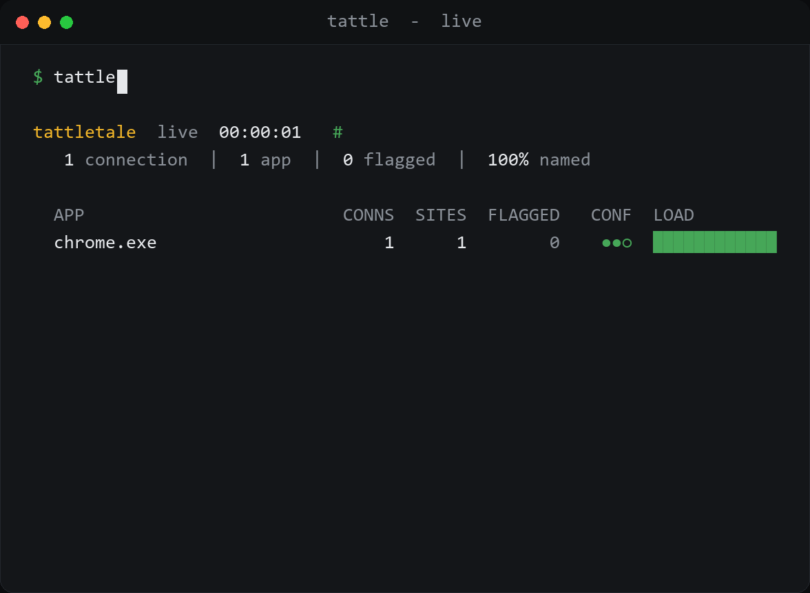
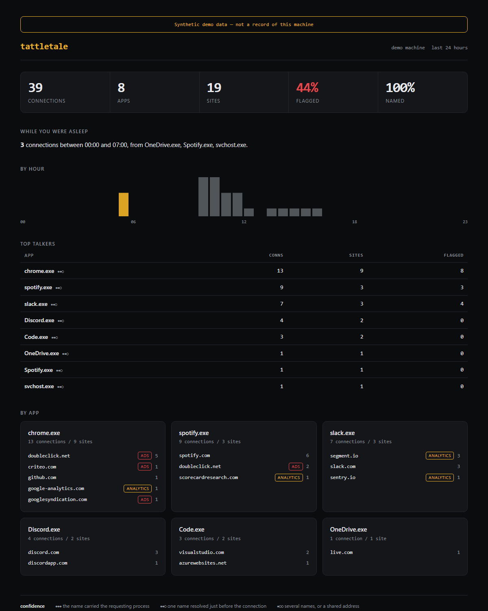

<div align="center">



# tattletale

**Your apps are talking behind your back. Here are the receipts.**

A single Windows binary that shows which application contacted which company,
when, and how often — then writes it up as one HTML receipt you can keep,
print, or post.

[](https://github.com/0DukePan/tattletale/actions/workflows/ci.yml)
[](https://github.com/0DukePan/tattletale/releases/latest)
[](https://github.com/0DukePan/tattletale/releases)
[](LICENSE)
[](#requirements)

```powershell
irm https://raw.githubusercontent.com/0DukePan/tattletale/main/install.ps1 | iex
```

No account. No cloud. No packet capture. No admin prompt.

</div>

---

## Why

You can see your bandwidth anywhere. Seeing the *pattern* — which app, which
company, how often, and whether that company is on a public tracker list — is
almost impossible without commercial software that reports on you itself.

`tattletale` reads metadata Windows already keeps. It does not capture packets,
does not intercept TLS, and does not send anything anywhere.

## The receipt



One self-contained HTML file: headline numbers, an hour-by-hour chart, a top
talkers table, per-app cards, a confidence legend and a print stylesheet. It
opens from a USB stick with no network.

The image above comes from `tattle demo`, which is why it carries a
synthetic-data banner. A real receipt names your machine and shows your numbers.

## Install

**Windows 10 or 11**, no administrator rights needed.

```powershell
irm https://raw.githubusercontent.com/0DukePan/tattletale/main/install.ps1 | iex
```

The installer downloads the latest release, checks its SHA256 against the
published checksum, and puts `tattle.exe` under `%LOCALAPPDATA%\tattletale\bin`.
Or download the zip from [Releases](https://github.com/0DukePan/tattletale/releases)
and put the binary on your `PATH` yourself.

### From source

```powershell
git clone https://github.com/0DukePan/tattletale
cd tattletale
cargo build --release
.\target\release\tattle.exe doctor
```

Requires [Rust](https://rustup.rs). This project is developed on a machine with
no Visual Studio Build Tools, so the local toolchain is GNU with
[WinLibs](https://winlibs.com) MinGW; CI builds the released binaries with MSVC.
See [CONTRIBUTING.md](CONTRIBUTING.md).

<a id="requirements"></a>

## Requirements

Windows 10 or 11, x86-64. Nothing else — no .NET, no Visual C++ redistributable,
no driver, no service. The binary is about 2.8 MB.

## Usage

```powershell
tattle                      # live view, until Ctrl-C
tattle report --open        # write a receipt and open it
tattle demo                 # a labelled example, before recording anything
```

| Command | What it does |
|---|---|
| `tattle` | Live table of what is talking right now |
| `tattle report --since 24h --open` | Write and open an HTML receipt |
| `tattle watch --duration 10m` | Record for a fixed time |
| `tattle top --since 24h --by sites` | Rank apps, sites or domains in the terminal |
| `tattle app chrome` | One application's traffic, by site |
| `tattle demo` | A clearly labelled synthetic day |
| `tattle lists update` | Download public tracker lists — the only outbound request |
| `tattle lists status` | Show which lists are loaded and where they came from |
| `tattle doctor` | Check whether this machine can be measured |
| `tattle purge` | Delete everything it has recorded |
| `tattle top --json` | Machine-readable output for scripts |

Global flags: `--db <PATH>`, `--json`, `--no-color`.

## How it works

| Source | What it gives | Cost |
|---|---|---|
| `GetExtendedTcpTable` | every TCP connection and its owning process | ~0.6 ms per poll |
| `ipconfig /displaydns` | name → address pairs the resolver currently holds | ~40 ms, every 3 s |
| `GetAdaptersAddresses` | this machine's own addresses, to drop self-connections | once a minute |

The first two are joined by address inside a 90-second window. That join is the
whole attribution system, and it is documented in
[docs/METHODOLOGY.md](docs/METHODOLOGY.md).

## How accurate is it?

Every row carries a confidence tier, and the tier is always shown:

| Tier | Meaning |
|---|---|
| ●●● **Exact** | The DNS event named the requesting process. Requires admin; **never produced in v0.1**. |
| ●●○ **High** | Exactly one name resolved in the 90 seconds before the connection. |
| ●○○ **Probable** | Several names, or the address is shared between applications. |
| ○○○ **Unknown** | No name resolved. The address is shown, and no guess is made. |

**It would rather say "unknown" than invent a name.** A privacy report that
accuses the wrong application is worse than no report at all.

### The known blind spot

Browsers using DNS over HTTPS resolve names inside their own process. Those
lookups never reach the Windows resolver cache, so their connections arrive as
bare addresses.

The tool does not hide this. The receipt reports the fraction of connections it
could name, next to the headline numbers, and names the applications bypassing
the system resolver. On the machine this was built on, that figure was **15%**.

Recovering browser lookups is the first item in
[v0.1.1](CHANGELOG.md#unreleased).

## Privacy

| | |
|---|---|
| **Reads** | the connection table, process image paths, the resolver cache, interface addresses |
| **Sends** | nothing, except `tattle lists update`, which you must invoke |
| **Stores** | a SQLite database at `%LOCALAPPDATA%\tattletale\tattletale.db` |
| **Retention** | 7 days of connections, 24 hours of name observations |
| **Delete** | `tattle purge` |

These are enforced, not just promised. `tests/privacy.rs` fails the build if a
second HTTP client appears, if the receipt gains an external reference, or if a
hostname reaches the HTML unescaped. [SECURITY.md](SECURITY.md) states exactly
what the program reads and sends, and how to check it yourself.

The database is **not encrypted**. It is a record of what this machine talked to,
protected by your user profile's permissions. If that is not sufficient for your
threat model, do not run the tool.

## FAQ

**Does it need administrator rights?**
No, and that is a design constraint — everything it reads is available to a
standard user. The exact-confidence tier needs ETW and therefore elevation,
which is why v0.1 does not offer it.

**Does it block trackers?**
No. It reports. Blocking is a different product with a different failure mode.

**Why is the "named" percentage low on my machine?**
Because your browser resolves over HTTPS. See [the blind spot](#the-known-blind-spot).

**Does it work on macOS or Linux?**
Not yet. The engine is portable; the collectors are not. The `Collector` seam
exists for this and is the largest piece of available work.

**Is it a spyware detector?**
No. It has no access to content, only to the metadata Windows keeps about
connections, and it does not judge applications — only the domains they contact.

## Status

Early but functional: collector, DNS parser, attribution engine, SQLite and
in-memory stores, HTML receipt, live view, tracker lists, demo mode, purge.

- 106 tests; `cargo clippy --all-targets -- -D warnings` clean
- Verified against live Windows machines, not only against fixtures
- 72,999 tracker rules from OISD and EasyList; a 110-rule seed works offline
- [docs/METHODOLOGY.md](docs/METHODOLOGY.md) — how attribution works and where it fails
- [CHANGELOG.md](CHANGELOG.md) — what shipped and what is next

## Contributing

The most valuable contribution is a **false attribution**: a case where the tool
named the wrong application. There is an issue template for it. See
[CONTRIBUTING.md](CONTRIBUTING.md) for the build setup and the house rules.

## License

MIT. See [LICENSE](LICENSE).
